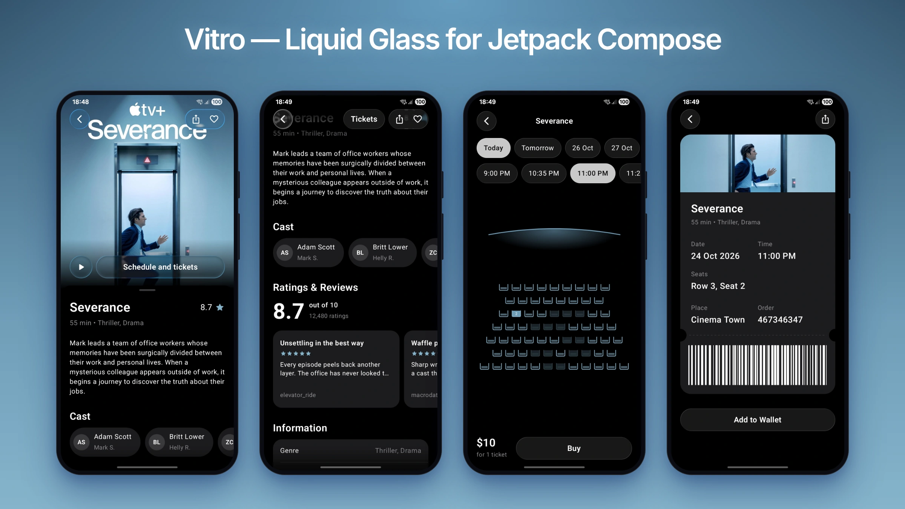
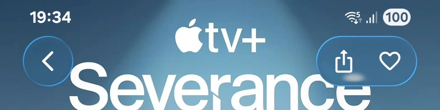

# Vitro

**Apple's Liquid Glass for Android.** A Jetpack Compose library rendered with custom AGSL shaders, calibrated against a real iPhone and optimized to render smoothly on any device.

[](https://central.sonatype.com/artifact/io.github.itshedimisawi/vitro)
[](#android-versions)
[](LICENSE)



Vitro brings Apple's Liquid Glass material to Android as plain Compose modifiers, so any composable can become glass. The API mirrors SwiftUI's `glassEffect`.

- **Faithful to iOS.** Every default was tuned side by side with captures from an iPhone running iOS 26: the rim's refraction and highlights, the blur, the light and dark materials, the shadow and the touch response.
- **Well optimized.** Rendering is kept lean: each piece of glass takes only a few GPU passes, grouped glass is drawn together at the cost of a single piece, glass out of sight isn't rendered, and the content behind the glass is sampled off the render thread. Scrolling and touch stay smooth, even on entry-level phones.
- **Works from Android 6.** Android 13 and later get the full shader effect; older versions get a close approximation.

<p align="center">
  
</p>

## Features

- Refraction at the rim, colour fringing, highlights and a soft shadow
- `Regular` and `Clear` glass, tinting, dimming and glass that reacts to touch
- Light and dark materials that adapt to the content behind them
- Nearby glass that blends into one surface
- A scroll edge effect for content passing under bars

## Installation

```kotlin
dependencies {
    implementation("io.github.itshedimisawi:vitro:0.1.0")
}
```

Vitro is available on Maven Central and needs Jetpack Compose 1.12 or later.

## Quick start

Glass shows a *backdrop*: the content you mark with `glassBackdrop`. Create one, mark the content, and pass it to each piece of glass.

```kotlin
val backdrop = rememberGlassBackdrop()

Box {
    Image(
        painter = painterResource(R.drawable.photo),
        contentDescription = null,
        modifier = Modifier.fillMaxSize().glassBackdrop(backdrop),
    )
    Text(
        text = "Hello",
        modifier = Modifier
            .align(Alignment.BottomCenter)
            .glassEffect(backdrop, Glass.Regular.interactive())
            .padding(horizontal = 24.dp, vertical = 16.dp),
    )
}
```

## Usage

### Glass variants

```kotlin
Modifier.glassEffect(backdrop)                                    // Glass.Regular in a capsule
Modifier.glassEffect(backdrop, Glass.Clear.dimmed())              // see-through, over photos
Modifier.glassEffect(backdrop, Glass.Regular.tint(Color.Blue))    // a prominent button
Modifier.glassEffect(backdrop, shape = RoundedCornerShape(16.dp))
Modifier.glassEffect(backdrop, if (reduceTransparency) Glass.Identity else Glass.Regular)
```

Every property (blur, refraction, magnification, saturation, light angle, shadow, …) can be changed with `Glass.copy(...)`.

### Content colour and touch

`GlassEffectState` tells you which material the glass shows and how it's being touched. Its `contentColor` is a legible colour for text and icons, which follows the material and any strong tint:

```kotlin
val state = rememberGlassEffectState()
Icon(
    Icons.Rounded.Share,
    contentDescription = "Share",
    tint = state.contentColor,
    modifier = Modifier.size(44.dp).glassEffect(backdrop, Glass.Regular.interactive(), state = state).padding(11.dp),
)
```

To force a material, use `Glass.Regular.copy(appearance = GlassAppearance.Dark)`. If your app has its own dark theme setting, provide it once so glass follows it instead of the system:

```kotlin
CompositionLocalProvider(LocalGlassDarkTheme provides isAppInDarkTheme) { App() }
```

### Clickable glass

Share one `MutableInteractionSource` between the glass and its `clickable`, so keyboard and D-pad clicks press the glass too. Pass `indication = null`, since the glass gives its own press feedback.

```kotlin
val source = remember { MutableInteractionSource() }
Box(
    Modifier
        .glassEffect(backdrop, Glass.Regular.interactive(), interactionSource = source)
        .clickable(source, indication = null, onClick = onClick),
)
```

### Grouping glass

Wrap controls that sit together in `glassEffectContainer`. Nearby pieces blend into one surface, and the whole group draws at the cost of one piece. With `spacing = 0.dp` nothing blends.

```kotlin
Row(Modifier.glassEffectContainer(), horizontalArrangement = Arrangement.spacedBy(8.dp)) {
    Icon(Icons.Rounded.Edit, "Edit", Modifier.size(44.dp).glassEffect(backdrop).padding(11.dp))
    Icon(Icons.Rounded.Delete, "Delete", Modifier.size(44.dp).glassEffect(backdrop).padding(11.dp))
}
```

### Scroll edge effect

Softens content where it scrolls under bars. Glass bars are found automatically; pass the system bar heights for the rest.

```kotlin
val systemBars = WindowInsets.systemBars.asPaddingValues()
Column(
    Modifier
        .glassBackdrop(backdrop)
        .background(MaterialTheme.colorScheme.background)
        .scrollEdgeEffect(top = systemBars.calculateTopPadding(), bottom = systemBars.calculateBottomPadding())
        .verticalScroll(rememberScrollState()),
) { ... }
```

## API

| Vitro | SwiftUI |
|---|---|
| `Modifier.glassEffect(backdrop, glass, shape)` | `.glassEffect(_:in:)` |
| `Glass.Regular` / `Clear` / `Identity` | `.regular` / `.clear` / `.identity` |
| `.tint(color)`, `.interactive()`, `.dimmed()` | `.tint(_:)`, `.interactive()` |
| `Modifier.glassEffectContainer(spacing)` | `GlassEffectContainer(spacing:)` |
| `Modifier.scrollEdgeEffect(top, bottom, style, …, isTopHidden, isBottomHidden)` | `.scrollEdgeEffectStyle(_:for:)`, `.scrollEdgeEffectHidden(_:for:)` |
| `rememberGlassBackdrop()`, `Modifier.glassBackdrop(backdrop)` | (implicit) |
| `rememberGlassEffectState()`, `LocalGlassDarkTheme` | |

## Tips

- Apply `glassEffect` after size and padding modifiers.
- Order the backdrop modifiers as `glassBackdrop(backdrop).background(page).scrollEdgeEffect(…)`: the background must come after `glassBackdrop` to be part of what glass shows, and `scrollEdgeEffect` goes anywhere after `glassBackdrop`.
- Glass shapes always have round corners; a `CutCornerShape` is drawn rounded.
- Use glass for controls and navigation that float above content, not for the content itself.

## Android versions

| Android | Rendering |
|---|---|
| 13+ (API 33) | Full effect, drawn with an AGSL shader |
| 12 (API 31–32) | Platform blur with an approximated lens |
| 6–11 (API 23–30) | Blurred snapshot with an approximated lens |

## Sample

The `sample` module is a three-screen cinema booking flow (film details, seat selection and ticket) with Liquid Glass toolbars, buttons and chips.

```
./gradlew :sample:installDebug
```

## Contributing

Issues and pull requests are welcome. Before opening a pull request, run:

```
./gradlew :vitro:check
```

This runs the unit tests, lint and a check of the public API against `vitro/api/vitro.api`. If you change the public API on purpose, update that file with `./gradlew :vitro:apiDump`.

## License

Apache License 2.0. See [LICENSE](LICENSE).

Vitro is an independent project and is not affiliated with Apple Inc.
